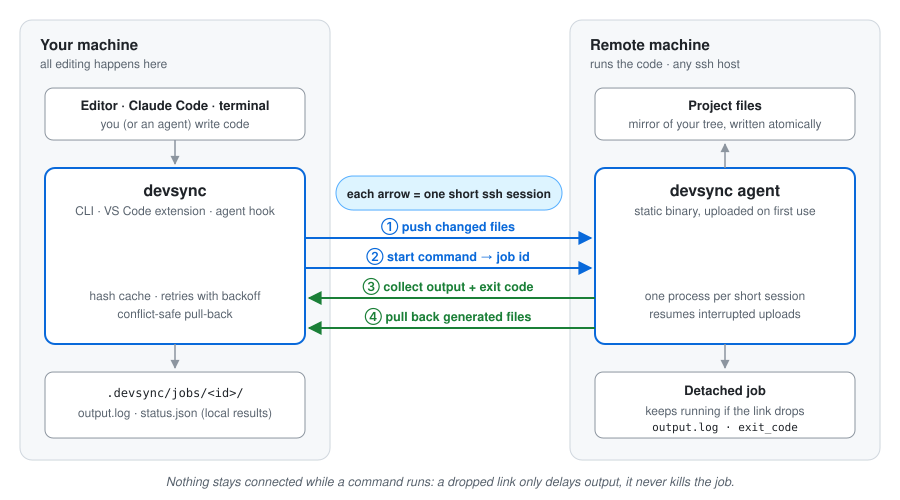
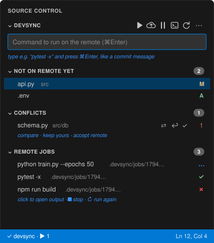

<div align="center">


# devsync

**Edit locally, run remotely.**<br>
Sync and remote execution for flaky connections, for you and your coding agent.

[](https://github.com/umerghafoor/dev-sync/actions/workflows/ci.yml)
[](https://github.com/umerghafoor/dev-sync/releases)
[](https://umerghafoor.github.io/dev-sync/)
[](LICENSE)

[Documentation](https://umerghafoor.github.io/dev-sync/) ·
[Quick start](#quick-start) ·
[VS Code extension](extensions/vscode/README.md) ·
[Changelog](CHANGELOG.md) ·
[Contributing](CONTRIBUTING.md)

</div>

---

devsync is for when you write code on one machine and run it on another: a
GPU server, a lab workstation, a cloud VM, a Raspberry Pi. You and your
coding agent edit locally at full speed, and the code runs on the remote as
if it were local. A dropped connection never freezes your editor or kills a
running command.

<p align="center">
  
</p>

## Features

- **No long-lived connections.** Every operation is a short ssh session.
  Commands run detached on the remote; output and exit codes are collected
  into `.devsync/jobs/<id>/` locally. A dropped link only delays output.
- **Feels local.** `devsync exec -- pytest` runs in the matching remote
  directory, streams output, keeps the exit code, and brings back files the
  command generated, without ever overwriting your local edits.
- **Resumable, verified sync.** Content-hashed (BLAKE3), compressed, resumed
  after interruptions, written atomically. Gitignored files such as `.env`
  are synced; `node_modules`, `.venv` and `.git` are not.
- **Coding-agent integration.** A Claude Code hook sends test, build and
  install commands to the remote automatically. `AGENTS.md` instructions
  cover other agents.
- **Nothing to install remotely.** A small static agent is uploaded over ssh
  on first use (Linux x86_64/arm64, any distribution).
- **VS Code extension** with sync status, remote runs, a jobs view, a remote
  shell and conflict diffs.
- **Built for bad networks.** Backoff with jitter, keepalives, timeouts, an
  offline queue in watch mode, and resumable uploads.

## Quick start

Requirements: ssh access to the remote without a password prompt
(`ssh you@server true` works). Nothing needs to be installed there.

**Install** (macOS and Linux):

```bash
curl -fsSL https://raw.githubusercontent.com/umerghafoor/dev-sync/main/install.sh | sh
```

The installer downloads the latest release for your machine, verifies its
checksum, installs to `~/.local/bin`, adds it to your `PATH`, and installs the
VS Code extension if `code` is available. Or build from source (Rust 1.88+):

```bash
git clone https://github.com/umerghafoor/dev-sync.git
cd devsync
sh install.sh
```

Then open a new terminal. Options: `sh install.sh --help`; to remove:
`sh install.sh --uninstall`.

**Use it** in your project:

```bash
cd ~/code/myproject
devsync init you@server:~/myproject
devsync doctor
devsync exec -- pytest -x
```

**Day to day:**

| Command | What it does |
| --- | --- |
| `devsync watch` | Push on every save; keeps working offline |
| `devsync exec -- <cmd>` | Sync, run remotely, stream output, return the exit code |
| `devsync submit -- <cmd>` | Start a background job; prints its id |
| `devsync logs [id]` | Follow a job (Ctrl-C detaches) |
| `devsync jobs` / `devsync kill [id]` | List / stop jobs |
| `devsync shell` | Interactive shell in the matching remote directory |
| `devsync forward 3000` | `localhost:3000` → remote port 3000, auto-reconnecting |
| `devsync pull [paths…]` | Get the remote's changes, all or just some files/folders (never overwrites your edits) |
| `devsync ls --changed` | See what changed on the remote before pulling |
| `devsync status` | Link state, pending changes, running jobs |
| `devsync setup claude` | Route Claude Code's commands to the remote |

Full guide: **[documentation](https://umerghafoor.github.io/dev-sync/)** (also
readable in [`docs/src`](docs/src/SUMMARY.md)).

## Coding agents

```bash
devsync setup claude
devsync setup agents-md
```

With the Claude Code hook installed, `pytest`, `npm install`,
`python app.py`, `make` and similar commands run on the remote. Output and
exit code come back as if they ran locally. `git`, `grep` and file edits stay
local. See [Coding agents](docs/src/guide/coding-agents.md).

## VS Code



A **devsync panel in Source Control**, next to Git:

- type a command and press **⌘Enter** to run it on the remote, like a commit;
- **Not on remote yet**: files waiting to be sent (**A**/**M**/**D**);
- **Conflicts**, with compare / keep yours / accept remote;
- **Remote jobs**, marked ✓ / ✗ / …; click one to open its output;
- status bar: ✓ synced · ☁ offline · ⏸ paused;
- a Getting Started walkthrough inside VS Code.

Install: download `devsync-<version>.vsix` from a release (or run
`make vscode`), then **Extensions → ⋯ → Install from VSIX…**. Guide:
[VS Code extension](docs/src/guide/vscode.md).

<br clear="right">

## How it works

| Crate | Role |
| --- | --- |
| [`devsync-proto`](crates/devsync-proto) | Framed postcard protocol shared by both sides |
| [`devsync-fs`](crates/devsync-fs) | Ignore rules, hashing with cache, sync planning, atomic writes |
| [`devsync-agent`](crates/devsync-agent) | Remote endpoint: transfers and detached job supervisor |
| [`devsync-transport`](crates/devsync-transport) | Short ssh/local sessions, agent deployment, retry/backoff |
| [`devsync-client`](crates/devsync-client) | Push, pull-back, job collection, agent hook |
| [`devsync-cli`](crates/devsync-cli) | The `devsync` binary (client and agent) |

Design details: [How it works](docs/src/architecture.md) ·
Comparison: [devsync vs Remote-SSH, rsync, Mutagen, …](docs/src/comparison.md)

## Contributing

Contributions are welcome. Please read [CONTRIBUTING.md](CONTRIBUTING.md) and
the [Code of Conduct](CODE_OF_CONDUCT.md). To report a vulnerability, follow
[SECURITY.md](SECURITY.md) rather than opening a public issue.

```bash
make check
make docs-serve
```

## License

[MIT](LICENSE) © Umer Ghafoor and devsync contributors.
