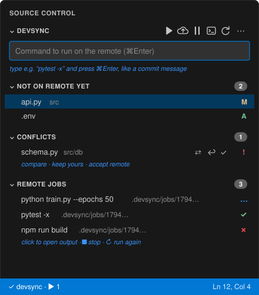

# VS Code extension

The extension adds a **devsync panel to Source Control** that works like
Git's: type a command where you'd write a commit message, press ⌘Enter, and
it runs on the remote. It is a thin UI over the `devsync` CLI, so the editor,
your terminal and coding agents all share one sync engine and one results
folder.

## Install

1. Install the CLI (see [Installation](../installation.md)). The extension
   finds `devsync` on `PATH`, in `~/.local/bin` or in `~/.cargo/bin`.
2. In VS Code: **Extensions** (⇧⌘X) → **⋯** → **Install from VSIX…** →
   choose `devsync-<version>.vsix` (from a release, or `make vscode`).
3. A **Get started with devsync** walkthrough opens; it is also under
   Help → Welcome.

## Connect a project

Open the project folder, then run **devsync: Connect Project to Remote…**
(also offered in the Source Control view) and enter `you@server:~/myproject`.
Accept **Run Doctor** to check the connection; it also installs devsync's
helper on the remote.

## The devsync panel

Open **Source Control** (⌃⇧G). The devsync section has:

| Part | What it's for |
| --- | --- |
| **Command box** | Type a command, press **⌘Enter / Ctrl+Enter**: it syncs, then runs in a terminal on the remote, in the folder of the file you have open |
| **Not on remote yet** | Local changes not sent yet, marked **A** (added), **M** (modified), **D** (deleted, when `sync.delete` is on). Click to open. With auto sync this list empties a moment after you save; when offline it shows what's queued |
| **Conflicts** | A remote command changed a file you also edited. Your file is kept; the remote version is next to it. Buttons: **⇄ Compare**, **↩ Keep yours**, **✓ Accept remote** |
| **Remote jobs** | The last 20 commands, marked **✓** (exit 0), **✗** (failed), **…** (running), **?** (lost). Click to open the output; **■** stops a running job, **↻** runs it again |

**Toolbar:** ▶ run · ⬇ pull from remote · ☁ push now · ⏸ pause / ⟳ resume auto sync ·
terminal · refresh. Under **⋯**: run in background, run again, collect
results, forward ports, status, doctor, Claude Code setup, Getting Started.

## The devsync sidebar (Activity Bar)

The extension also adds a **devsync icon to the Activity Bar** (the left bar,
under Explorer, Search, Source Control…). Its sidebar has the same lists plus
a bigger **Run** box:

| Section | What it's for |
| --- | --- |
| **Run** | Status dot and remote address, a command field, a full-width **▶ Run on Remote** button, **Run in Background** and **Terminal**, and your **Recent** commands (click to edit, ▶ to run again). Enter runs; ⌘Enter runs in the background; Shift+Enter adds a line |
| **Not on Remote Yet** | Same A/M/D list as in Source Control, with Pull, Pull Files…, Push and Pause/Resume buttons |
| **Conflicts** | Appears only when there are conflicts |
| **Remote Jobs** | ✓ / ✗ / spinner for each job; click for output; ■ stop, ↻ run again |

The icon shows a **count badge**: changes not yet on the remote, plus
conflicts. **⌘⌥D / Ctrl+Alt+D** opens the sidebar with the cursor in the Run
field.

You can drag the icon to reorder it, or drag the devsync sections into the
Secondary Side Bar. If you only want the sidebar, set
`devsync.sourceControl` to `false` to hide devsync from the Source Control view.

### Pulling from the remote

- **⬇ Pull All** (sidebar) or **Pull Everything from Remote**: get every
  remote change. Your edits are never overwritten; conflicts appear under
  **Conflicts**.
- **Pull Files…**: choose remote files or folders from a searchable list
  (changes only by default; the list button shows everything).
- **Right-click** a file or folder in the Explorer, or an editor tab, then
  choose **devsync: Pull from Remote** for just that item.

## Status bar

| Shows | Meaning |
| --- | --- |
| `✓ devsync` | Remote matches your files |
| `☁↑ devsync: changes` | Saved changes about to be sent |
| `⟳ devsync: syncing` | Sending |
| `☁ devsync: offline` | Can't reach the remote; changes are queued and retried (yellow) |
| `⏸ devsync: paused` | Auto sync is off; use Push |
| `· ▶ 2` | Two remote jobs running |

Click it for a menu with every action.

## Running things

- **Quick runs** go through the command box. **⌘⌥R / Ctrl+Alt+R** (or ▶ in
  the editor title bar) re-runs the last command; bind it to any key you like.
- **Long runs**: ⋯ → **Run on Remote in Background**. The job runs without
  holding a connection. Its output file opens and fills in as it runs, and
  you're notified when it finishes.
- **Remote terminal**: the terminal button, or the *devsync remote terminal*
  profile in the terminal **+ ▾** menu.
- **Ports**: ⋯ → **Forward Ports** exposes `exec.ports` on localhost.

## Settings

| Setting | Default | |
| --- | --- | --- |
| `devsync.binaryPath` | `""` | Path to `devsync`. Empty: searches `PATH`, `~/.local/bin`, `~/.cargo/bin`, `/usr/local/bin`, `/opt/homebrew/bin` |
| `devsync.autoSync` | `true` | Send every save automatically when a devsync project opens |
| `devsync.sourceControl` | `true` | Also show devsync in the Source Control view (the Activity Bar sidebar is always there) |
| `devsync.openOutputOnBackgroundRun` | `true` | Open a background job's output when it starts |

The extension activates in any workspace containing a `.devsync.toml`. Logs
are under View → Output → **devsync**.
