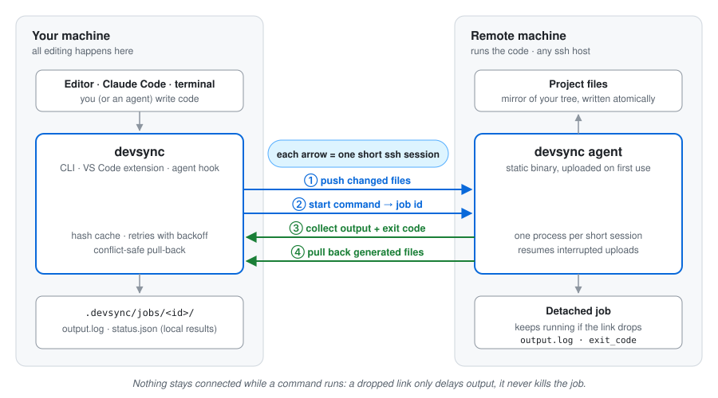

# devsync

**Edit locally, run remotely.**

devsync is for working on one machine and running the code on another: a
GPU server, a lab workstation, a cloud VM, an embedded board. It is built
for networks that drop.

- You (or a coding agent such as Claude Code) edit files **locally**, at full
  speed, with any editor. Nothing freezes when the network does.
- `devsync exec -- pytest` sends the changed files, runs the command on the
  remote **in the matching directory**, streams the output, keeps the exit
  code, and copies back files the command generated.
- Commands run **detached** on the remote. Every exchange is a short ssh
  session, so a dropped connection only delays output and never kills the
  command. Results are collected into `.devsync/jobs/<id>/` on your machine.
- Nothing needs to be installed on the remote: devsync uploads its own small
  static agent over ssh.

## Where to go next

- [Install devsync](installation.md), then follow the [quick start](quick-start.md).
- Using Claude Code or another agent? See [Coding agents](guide/coding-agents.md).
- Prefer an editor UI? See the [VS Code extension](guide/vscode.md).
- Curious how it survives bad networks? Read [How it works](architecture.md).
